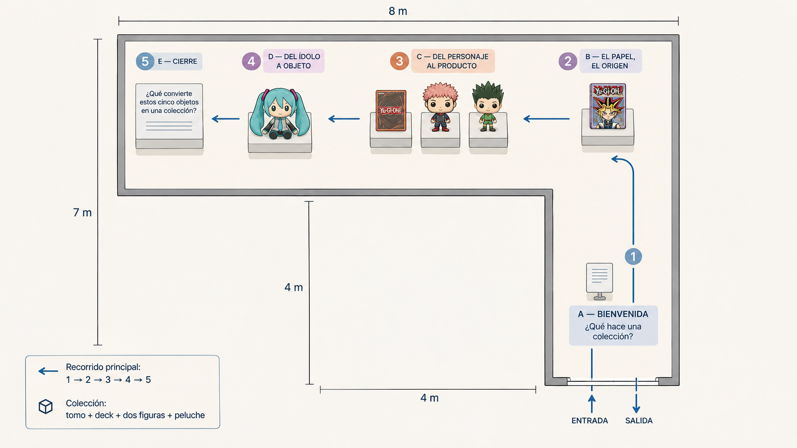

# Del papel al objeto

> Exposición virtual sobre la occidentalización de la cultura popular japonesa y la formación de colecciones.

## Sobre el proyecto

**Del papel al objeto** propone una experiencia museal virtual para explorar cómo personajes y narrativas de la cultura popular japonesa circulan en Occidente y se convierten en objetos coleccionables. La exposición relaciona cinco piezas y cierra con una pregunta para el visitante: **¿qué convierte un grupo de objetos en una colección?**

La experiencia está dirigida tanto a aficionados al manga, el anime y los juegos de cartas como a visitantes sin conocimientos previos. La identidad visual tendrá un carácter geek y de cultura pop, con acentos gráficos por estación y una sala legible que mantenga las piezas en primer plano.

## Objetivos de experiencia

- Recorrer libremente una sala virtual compacta con cinco estaciones.
- Reconocer qué es cada objeto y comprender su relación con la cultura popular japonesa, incluso sin conocer previamente sus franquicias.
- Observar cómo cambia un personaje al pasar entre formatos impresos, cartas, figuras y objetos textiles.
- Distinguir entre acumulación, inventario y colección, y proponer un criterio propio para agrupar las piezas.
- Usar la experiencia desde computador y móvil con controles adecuados a cada dispositivo.

## Recorrido y contenido

| Estación | Tema | Contenido e interacción prevista |
|---|---|---|
| A. Bienvenida | Orientación | Introducción a la pregunta curatorial, instrucciones de navegación y acceso a una sugerencia de recorrido. |
| B. El papel, el origen | Manga y narrativa gráfica | Tomo de *Yu-Gi-Oh!*; contexto editorial y lectura; visualización de páginas cuando los materiales estén disponibles. |
| C. Del personaje al producto | Licencia y producción comercial | Deck de Kaiba y figuras Funko Pop de Yuji Itadori y Gon Freecss; inspección de piezas y comparador papel–figura. |
| D. El ídolo que se vuelve objeto | De lo digital a lo tangible | Peluche de Hatsune Miku; explicación de la cultura de ídolos virtuales y de su materialización textil. |
| E. ¿Qué hace una colección? | Criterio curatorial | Actividad para agrupar los cinco objetos con un criterio propio y compararlo con el criterio de la exposición. |

El visitante podrá moverse sin un orden obligatorio. Se ofrecerá una orientación inicial y señales dentro de la sala para ayudar a encontrar las estaciones. Los textos principales serán breves y claros; el vocabulario especializado podrá explicarse mediante ayudas complementarias.

## Alcance de la primera versión

### Incluido

- Sala 3D compacta y navegable libremente.
- Las cinco estaciones y sus textos curatoriales principales.
- Interacción para inspeccionar las piezas (giro y acercamiento cuando el modelo lo permita).
- Comparador papel–figura en la estación C, sujeto a contar con imágenes o modelos adecuados.
- Actividad de clasificación y pregunta de cierre en la estación E.
- Controles para escritorio y móvil, interfaz adaptable y orientación básica.
- Accesibilidad inicial: textos legibles, contraste suficiente, instrucciones visibles y alternativa textual para información visual importante.
- Publicación web compartible y documentación para ejecutar y actualizar el proyecto.

### Fuera del alcance inicial

- Realidad virtual con visor.
- Mediación en vivo, chat o asistentes con inteligencia artificial.
- Modelado de alta complejidad para cada pieza antes de validar navegación y rendimiento.
- Una experiencia 2D con el mismo nivel de desarrollo que la sala 3D.

## Tecnología y criterios técnicos

La opción inicial es **PlayCanvas** para la sala 3D en navegador. La decisión se validará con una prueba temprana de navegación en escritorio y móvil. Los modelos se prepararán en Blender y se integrarán en un formato web optimizado como glTF/GLB.

El rendimiento móvil se tratará como requisito de diseño: geometría y texturas optimizadas, iluminación contenida, pocos efectos costosos y carga progresiva de recursos cuando sea posible. Durante el desarrollo se utilizarán modelos provisionales para que la sala y las interacciones avancen en paralelo al modelado final.

### Controles previstos

| Acción | Escritorio | Móvil |
|---|---|---|
| Moverse | WASD o flechas | Joystick virtual |
| Mirar alrededor | Ratón | Arrastrar sobre la vista |
| Interactuar | Clic o tecla indicada en pantalla | Toque sobre el objeto o botón |
| Cerrar panel | Esc o botón de cierre | Botón de cierre visible |

Los controles finales se confirmarán en el prototipo y se mostrarán en la experiencia.

## Materiales disponibles y dependencias

Al inicio se cuenta con fotografías de los objetos. Estas servirán como referencia para proporciones, color y detalles durante el modelado. El equipo producirá los modelos 3D y aportará los materiales visuales que se acuerden para páginas, empaques y comparaciones.

Antes de cerrar cada pieza se deberán registrar sus datos de identificación y procedencia, y confirmar los materiales que pueden incorporarse a la exposición. La estación del manga contempla una adquisición propuesta en el guion; su representación y rotulación deben distinguir claramente una pieza propuesta de una pieza efectivamente disponible.

## Plan de trabajo: una semana

| Día | Enfoque | Entregable |
|---|---|---|
| 1 | **Completado:** cerrar geometría, estaciones, piezas, secuencia principal, controles previstos y criterios de diseño. | Plano cenital de referencia y decisiones documentadas en este README. |
| 2 | Montar sala en L, estaciones provisionales y controles de recorrido para desktop y móvil. | Blockout 3D de la sala con navegación libre. |
| 3 | Integrar paneles, cédulas, orientación y contenido de las cinco estaciones. | Exposición completa en contenido. |
| 4 | Integrar modelos provisionales o finales; añadir inspección de piezas y comparador. | Piezas explorables y comparación funcional. |
| 5 | Implementar actividad de clasificación y cierre curatorial. | Interacción final conectada con los objetivos de aprendizaje. |
| 6 | Ajustar interfaz móvil, legibilidad, carga y accesibilidad básica. | Versión adaptable revisada en los dispositivos disponibles. |
| 7 | Corregir problemas, publicar y documentar uso y actualización. | Enlace compartible y README actualizado con instrucciones reales. |

## Criterios de cierre

- Se puede entrar a la sala y recorrer libremente sus cinco estaciones.
- Una persona nueva entiende cómo moverse y puede identificar qué está observando.
- Los textos y paneles se leen sin bloquear innecesariamente la vista o el desplazamiento.
- La inspección de objetos, el comparador previsto y la actividad final funcionan con los recursos disponibles.
- La experiencia se puede abrir desde un navegador de escritorio y desde un navegador móvil actual.
- El proyecto queda publicado y este README incluye los pasos reales para ejecutarlo y actualizar sus recursos.

## Ejecución

La aplicación está en `web/` y usa PlayCanvas Engine, TypeScript y Vite. Requiere Node.js 22.23.2 o posterior.

```powershell
cd web
npm install
npm run dev
```

Vite inicia el servidor de desarrollo en `http://localhost:5173`. Para generar el sitio estático, ejecuta `npm run build` desde `web/`; la salida queda en `web/dist/`. Los modelos optimizados `.glb` se ubican en `web/public/models/` y las texturas externas en `web/public/textures/`. Consulta [`web/README.md`](web/README.md) para los comandos y la estructura completa.

## Créditos y fuentes

- Guion museológico, curatorial, museográfico, educativo y de mediación: documento del proyecto *Del papel al objeto*.
- Modelado y recursos visuales: equipo del proyecto (por completar).
- Referencias y créditos específicos de piezas, imágenes y materiales: por completar antes de publicar.

## Día 1 · Plano y criterios de diseño

### Plano cenital de referencia

El plano actualizado para orientar la construcción de la sala es `docs/plano_recorrido.png`. Presenta una sala en L de aproximadamente 40 m² (envolvente de 8 × 7 m con un vacío de 4 × 4 m), con el brazo horizontal extendido hacia la izquierda. La entrada y la salida están en la parte inferior.



El recorrido inicia en A. Desde la entrada, sube por el brazo vertical hasta B y continúa de **derecha a izquierda** por las estaciones B → C → D → E. Esta dirección retoma el sentido de lectura del manga. La ruta principal está señalizada; el espacio de exposición debe permitir detenerse y explorar sin bloquear el paso.

### Piezas representadas

| Estación | Piezas | Cantidad |
|---|---|---:|
| B. El papel, el origen | Tomo de manga *Yu-Gi-Oh!* | 1 |
| C. Del personaje al producto | Deck de Kaiba, Funko Pop Yuji Itadori #1111 y Funko Pop Gon Freecss #651 | 3 |
| D. El ídolo que se vuelve objeto | Peluche de Hatsune Miku | 1 |
| **Total** |  | **5** |

### Criterios para construir y revisar la sala

1. **Secuencia legible:** la ruta se entiende en el orden A → B → C → D → E; en el brazo horizontal avanza de derecha a izquierda.
2. **Orientación coherente:** el visitante reconoce entrada y salida en la parte inferior, y entiende el cambio desde el brazo vertical hacia el horizontal.
3. **Cinco piezas identificables:** se distinguen el tomo, el deck, las dos figuras Funko y el peluche en sus estaciones correspondientes.
4. **Fidelidad al guion:** la pieza de manga corresponde a *Yu-Gi-Oh!*; los objetos, rótulos y actividad final coinciden con el guion curatorial.
5. **Circulación despejada:** el paso entre entrada, estaciones y salida se mantiene libre; pedestales y paneles no invaden el recorrido.
6. **Comprensible para público nuevo:** cada estación identifica el objeto en lenguaje cotidiano y ofrece contexto antes de usar términos especializados.
7. **Exploración sin bloqueo:** la ruta está señalada, pero permite detenerse, observar y reanudar el recorrido sin perder la orientación.
8. **Legibilidad en móvil:** rótulos e indicaciones se leen en pantalla pequeña; las acciones no dependen de apuntar con precisión.
9. **Estética equilibrada:** los acentos geek/pop dan identidad sin competir con las piezas ni saturar el espacio.
10. **Rendimiento:** la sala prioriza modelos y recursos visuales optimizados, especialmente para dispositivos móviles.

### Distribución de estaciones

| Orden | Estación | Ubicación según plano | Función |
|---:|---|---|---|
| 1 | A. Bienvenida | Brazo vertical, junto a la entrada | Orientación y pregunta guía. |
| 2 | B. El papel, el origen | Unión con el brazo horizontal, extremo derecho | Presentar el tomo de manga. |
| 3 | C. Del personaje al producto | Brazo horizontal, zona central | Reunir el deck y las dos figuras para comparar formatos. |
| 4 | D. El ídolo que se vuelve objeto | Brazo horizontal, hacia la izquierda | Presentar el peluche de Hatsune Miku. |
| 5 | E. ¿Qué hace una colección? | Brazo horizontal, extremo izquierdo | Cerrar con la actividad y la pregunta de colección. |

### Lista cerrada de tareas del Día 1

- [x] Adoptar como referencia la sala en L de aproximadamente 40 m², con el brazo horizontal hacia la izquierda.
- [x] Ubicar entrada y salida en el borde inferior.
- [x] Fijar el recorrido principal A → B → C → D → E y su avance de derecha a izquierda por el brazo horizontal.
- [x] Asignar las cinco piezas a sus estaciones: tomo de manga en B; deck y dos figuras en C; peluche en D.
- [x] Definir A como bienvenida y E como cierre con la actividad de criterio de colección.
- [x] Establecer el movimiento previsto: WASD/flechas y ratón en escritorio; joystick virtual y arrastre en móvil; clic/toque para interactuar.
- [x] Fijar la prioridad de contenidos: identificar cada objeto con palabras claras, dar contexto breve y dejar términos especializados como información complementaria.
- [x] Acordar la dirección visual: cultura geek/pop con acentos moderados y las piezas como foco.
- [x] Definir criterios para revisar circulación, orientación, legibilidad, accesibilidad inicial y rendimiento móvil.
- [x] Registrar qué debe comprobarse al construir la sala 3D.

**Estado del Día 1: cerrado.** El plano y las decisiones anteriores son la base de trabajo del Día 2. Las comprobaciones siguientes pertenecen a la validación del prototipo y no reabren esta etapa salvo que aparezca un problema concreto de navegación o espacio.

### Validaciones para el prototipo 3D

- Comprobar que el giro desde A hacia B y el avance de derecha a izquierda se sienten naturales con la cámara.
- Verificar que estaciones y objetos no estrechan el paso ni se tapan entre sí.
- Revisar tamaño y contraste de rótulos en escritorio y móvil.
- Confirmar los datos y la disponibilidad de cada pieza antes de publicar; el guion señala que la adquisición del manga es propuesta.

### Criterio de cierre del Día 1

El Día 1 se considera completado porque hay un plano cenital único de referencia, están ubicadas y nombradas las cinco estaciones, se contabilizan las cinco piezas, se fijaron el orden del recorrido y los controles previstos, y quedaron documentadas las condiciones que se revisarán en el prototipo.


## Día 2 · Sala base y navegación

### Estado

La infraestructura y el blockout están en `web/`, con PlayCanvas Engine, TypeScript y Vite. Tras revisar la sensación de espacio, la sala del prototipo se amplió a 84 m² y las piezas se acercaron al perímetro para despejar el centro. La cámara se fijó a 1,70 m con desplazamiento peatonal horizontal y balanceo muy leve al caminar. Los cinco objetos siguen representados por geometría provisional; faltan los GLB finales, las cédulas curatoriales y las interacciones de cada estación.

### Tareas completadas

- [x] Crear el proyecto local dentro del repositorio sin reemplazar el README, el guion ni el plano existentes.
- [x] Instalar dependencias y generar `package-lock.json` para fijar versiones.
- [x] Definir título, idioma y metadatos de la experiencia en HTML.
- [x] Documentar requisitos, comandos de ejecución y compilación.
- [x] Preparar ubicaciones para modelos GLB y texturas externas.
- [x] Sustituir el cubo de demostración por el blockout de la sala en L.
- [x] Colocar cinco estaciones y representaciones geométricas provisionales de las piezas.
- [x] Añadir navegación con teclado/ratón y joystick/gesto táctil.
- [x] Limitar el movimiento a la huella de la sala y permitir atravesar los umbrales de entrada/salida.
- [x] Ajustar cámara y movimiento a una sensación peatonal a 1,70 m.
- [x] Ampliar la sala a 84 m² y llevar estaciones y piezas hacia el perímetro.
- [x] Retirar el Inspector de PlayCanvas, quitar el overlay A–E e integrar el logo con resplandor de borde.
- [x] Señalizar las piezas con flechas flotantes visibles a distancia; mostrar nombre y acción al aproximarse y mirarlas.
- [x] Pausar el movimiento del recorrido durante la inspección en dispositivos táctiles, para que arrastrar la pieza no mueva al visitante.
- [x] Incorporar el plano cenital en un cuadro mural al comienzo del pasillo de entrada para orientar al visitante antes de recorrer las estaciones.
- [x] Mantener la cédula de inspección anclada a la derecha y reajustar el encuadre de la pieza al espacio libre en distintas dimensiones de pantalla.
- [x] Quitar la solicitud de pantalla completa al entrar desde móvil; la experiencia permanece en la ventana normal del navegador.
- [x] Crear pantalla inicial responsive con banner completo, opciones, carga y bienvenida temporizada.

### Decisiones de implementación

- **Huella del prototipo:** sala de 12 × 10 m con un cuadrante de 6 × 6 m abierto (84 m²); el brazo horizontal se extiende hacia la izquierda. El plano cenital del Día 1 conserva la distribución conceptual original de 40 m²; este blockout amplía esa propuesta tras la revisión de escala.
- **Recorrido:** inicio junto a la entrada en A; avance sugerido hacia B y luego de derecha a izquierda por C, D y E.
- **Montaje:** pedestales y paneles se acercan a los muros; la franja central queda abierta para circular.
- **Representación temporal:** formas geométricas sencillas para el tomo, el deck, las dos figuras y el peluche.
- **Escritorio:** WASD o flechas para moverse; clic sostenido y arrastre del ratón para mirar.
- **Móvil:** joystick virtual del lado izquierdo para moverse; arrastre táctil en el lado derecho para mirar.
- **Sensación de marcha:** altura ocular de 1,70 m, velocidad peatonal, movimiento horizontal sin vuelo y balanceo de cámara sutil.
- **Interfaz:** se retiró el Inspector de desarrollo; el overlay con la secuencia A–E se eliminó, el logo ocupa la esquina superior izquierda y los controles quedan abajo a la izquierda.
- **Inicio de experiencia:** el menú se reemplaza por una carga de 3 segundos sin ocultar el banner; después, el banner se transforma a su lugar habitual y un fade revela al visitante entre las puertas. El mensaje de bienvenida permanece 4 segundos y luego desaparece suavemente. Resolución y nivel de volumen se guardan localmente; el volumen quedará listo para cuando se integre música.
- **Señalización interactiva:** cada objeto interactuable tiene una flecha 3D pequeña sobre la pieza, con movimiento vertical continuo y sutil. Al ser parte de la sala, los muros la ocultan cuando no hay línea de visión. Al acercarse y mirar el objeto aparece además su nombre y la acción correspondiente.
- **Inspección móvil:** al abrir un objeto se pausa el recorrido mientras dura la inspección, evitando que el gesto de arrastre mueva simultáneamente al visitante.
- **Composición adaptable:** la cédula permanece a la derecha; el objeto se sitúa y escala en el área disponible a su izquierda. El encuadre se recalcula si cambia el tamaño o la orientación de la ventana.
- **Área de inspección:** el encuadre también reserva el espacio vertical del logo y la banda de instrucciones para que no tapen el objeto.
- **Pantalla móvil:** la experiencia permanece en la ventana normal del navegador; si el teléfono está en vertical, el aviso indica girarlo manualmente.
- **Orientación en sala:** el plano cenital se muestra enmarcado en la pared este, al inicio del pasillo de entrada, mirando hacia el recorrido; permite anticipar el flujo A → B → C → D → E antes de llegar a la primera estación.

### Siguiente implementación

Revisar la sensación de marcha, las flechas de orientación y la inspección en desktop y en un móvil real. Luego integrar textos curatoriales, paneles y acciones de interacción para las estaciones B–E, manteniendo la pauta de señalización para todo elemento interactuable.
